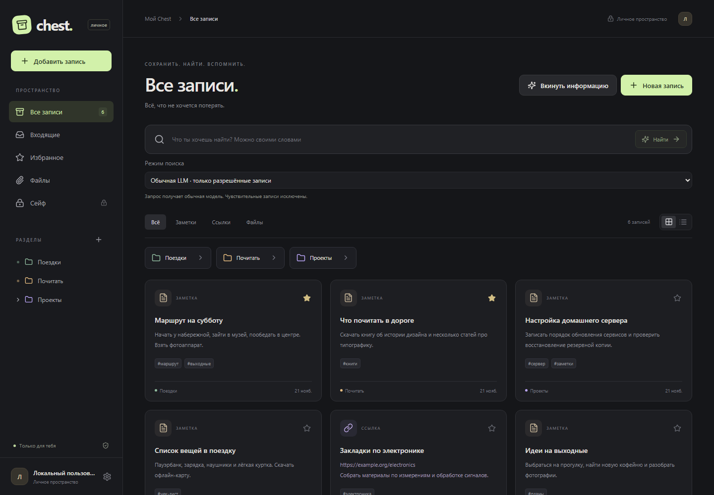
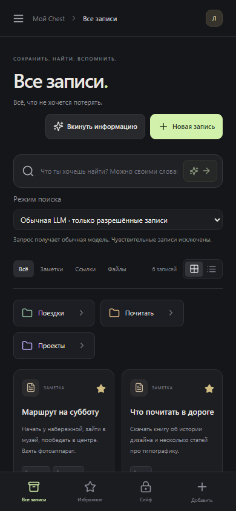

# TG.Chest

A self-hosted Telegram bot and Mini App for saving notes, links, forwarded messages, and files. Organize them in folders or search your archive from Telegram.

> This is a vibe-coded project built with OpenAI Codex and tested with a real Telegram bot and Mini App. It’s an experiment for personal use, with no guarantees that it works reliably or is easy to use.

[Screenshots](#screenshots) · [Quick start](#quick-start) · [How to use](#how-to-use) · [AI and privacy](#ai-and-privacy) · [Backups](#backups) · [Development](#development)

## Screenshots

The Mini App on desktop and mobile, populated with sample notes and folders.





## Quick start

Use a Linux host with Docker Compose, a domain pointing to the host, and ports 80 and 443 available for Caddy.

1. Create a bot in [BotFather](https://t.me/BotFather) and have your numeric Telegram user ID ready.
2. Copy `.env.example` to `.env`. Set `BOT_TOKEN`, `ALLOWED_TELEGRAM_IDS`, `DOMAIN`, and `PUBLIC_URL`. Use your domain without a scheme for `DOMAIN` and its HTTPS URL for `PUBLIC_URL`. Generate a database password with `openssl rand -hex 32` for `POSTGRES_PASSWORD`.
3. For a fresh installation, generate a file encryption key and put it in `.env` as `FILE_ENCRYPTION_KEY`. When restoring an archive, use its original key.

   ```bash
   docker compose build api
   docker run --rm tg-chest:local python -c 'from cryptography.fernet import Fernet; print(Fernet.generate_key().decode())'
   ```

4. Start the stack and send `/start` to your bot. Open the Mini App from the **Chest** menu or the button in the bot’s reply.

   ```bash
   docker compose up -d --build
   docker compose ps
   curl -fsS https://chest.example.com/api/health
   ```

The sample configuration stores attachments locally. To use Yandex Disk, authorize your own OAuth app with the `cloud_api:disk.app_folder` scope, set `YANDEX_DISK_TOKEN`, and switch `STORAGE_BACKEND` to `yandex`. For device authorization, save the OAuth app's `client_id` and `client_secret` in the ignored `yandex-client.secrets.json` file, then run `python scripts/connect_yandex.py start` and `python scripts/connect_yandex.py poll` with the project dependencies installed.

## How to use

| Task | Where to do it |
| --- | --- |
| Save something | Send or forward it to the bot. Use **Новая запись** in the Mini App to create a note manually. |
| Organize an archive | Use folders, nested folders, tags, and favorites in the Mini App. Use `/folder Work/Projects` to create a nested path from Telegram. |
| Find a note or file | Use `/find question` or the Mini App search. With AI configured, search can generate an answer with references to matching entries. |
| Turn a message into notes | Use **Вкинуть информацию** to submit text and attachments for AI processing. Open **Исходники и история** to view the original and edits. |
| Rewrite part of a note | Select a passage, choose **Предложить правку**, and review the change before applying it. |
| Store a password | Open **Сейф** or use `/password`. The optional master password hint appears before unlock. Keep the master password out of the hint. |

Text extraction supports common text files, DOCX, and PDFs with a text layer. Images and audio are searchable by their filename or caption.

## AI and privacy

Configure chat, organization, embeddings, and reranking in the Mini App under **Profile → Настроить модели и подключения**. The two AI providers have separate API URLs, keys, and model settings. Both use OpenAI-compatible APIs.

| Mode | What happens |
| --- | --- |
| Ordinary AI (`/public`) | Eligible notes, extracted file text, and search queries can be sent to the ordinary provider, such as OpenRouter. |
| Trusted AI (`/private`) | Eligible sensitive data is sent only to the separately configured trusted provider. |
| Local (`/local`) | Search uses local text matching and entries are kept out of model requests. |

Ordinary notes and extracted text are readable by the server for search. The vault encrypts passwords in the browser. Invoking the trusted vault assistant explicitly sends the selected decrypted fields through the app server to the trusted provider. The master password is required to decrypt the vault and cannot be recovered by the app.

## Backups

For backups to Yandex Disk, set `BACKUPS_ENABLED=true`, then install the [systemd service and timer](deploy/) on a Linux host. The supplied timer runs at 05:00 Krasnoyarsk time. Review the service paths and time zone before installing it. The default retention is seven days and the latest successful backup is always retained.

Snapshots include PostgreSQL, settings and local files that still need to be uploaded. Existing Yandex Disk attachments stay in place. Keep the backup directory private because it contains deployment credentials and the file encryption key. See the [restore guide (Russian)](deploy/README-RESTORE.md).

## Development

The app uses FastAPI, aiogram, PostgreSQL with pgvector, and React with Vite. For development, SQLite supports local text search.

On Windows, install Python 3.13 and Node.js 24. Copy `.env.example` to `.env` and set `ENVIRONMENT=development`, `DEV_AUTH=true`, `DATABASE_URL=sqlite:///./chest.db` and `STORAGE_BACKEND=local`.

```powershell
python -m venv .venv
.\.venv\Scripts\python -m pip install -r backend/requirements.lock
npm --prefix web ci
npm --prefix web run build
.\scripts\dev.ps1 migrate
.\scripts\dev.ps1 api
```

Open `http://127.0.0.1:8000` for the local Mini App preview. Run `.\scripts\dev.ps1 worker` in another terminal for queued tasks. Use `.\scripts\start-local.ps1` to start the full stack locally with a configured bot token and Telegram ID.

```powershell
.\.venv\Scripts\python -m pytest -q
npm --prefix web test
```
